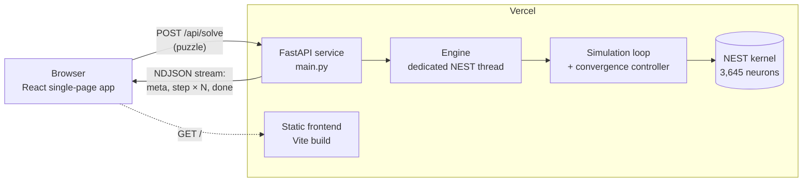

# Sudoku Solver using Spiking Neural Network

A web application that solves Sudoku puzzles with a **spiking neural network
(SNN)** simulated in the [NEST Simulator](https://www.nest-simulator.org/), and
shows the network's activity live in the browser.

**Live demo:** <https://sudoku-solver-using-spiking-neural-network.vercel.app/>


---

## Contents

1. [Overview](#1-overview)
2. [Features](#2-features)
3. [How the network solves Sudoku](#3-how-the-network-solves-sudoku)
4. [System architecture](#4-system-architecture)
5. [User interface](#5-user-interface)
6. [API reference](#6-api-reference)
7. [Results](#7-results)
8. [Technology stack](#8-technology-stack)
9. [Project structure](#9-project-structure)
10. [Running locally](#10-running-locally)
11. [Configuration](#11-configuration)
12. [Deployment](#12-deployment)
13. [Testing and quality](#13-testing-and-quality)
14. [Limitations](#14-limitations)
15. [Credits and licence](#15-credits-and-licence)

---

## 1. Overview

Sudoku can be expressed as a constraint-satisfaction problem: every row,
column and 3×3 box must contain each digit exactly once. This project solves
it without any search algorithm in the solving loop. A network of 3,645
leaky integrate-and-fire neurons encodes every possible digit in every cell.
The rules of Sudoku are wired in as inhibitory synapses, and random
background spikes let the network explore until it settles into a state that
breaks no rule.

The application lets a user enter or generate a puzzle, watch the network
solve it in real time, and then inspect how the network behaved: which
neurons won, how strongly they fired, and how their membrane potentials
evolved.

| | |
|---|---|
| **Problem** | Solve any valid 9×9 Sudoku puzzle |
| **Method** | Stochastic spiking neural network, a winner-take-all constraint network |
| **Simulator** | NEST 3.10.0, model `iaf_psc_exp` |
| **Network size** | 729 populations, 3,645 neurons, 521,235 connections |
| **Interface** | Single-page web app with live streaming of the simulation |
| **Deployment** | Vercel (static frontend and Python serverless backend) |

---

## 2. Features

### Puzzle input

| Feature | Description |
|---|---|
| Editable 9×9 grid | Type digits 1–9; Backspace, Delete or 0 clears a cell; arrow keys move between cells |
| Live validation | Duplicate digits in a row, column or box are highlighted, with a message such as "5 appears twice in row 3" |
| **Randomly Initialize** | Instantly generates a puzzle with 36 given digits and exactly one solution |
| **Clear Grid** | Empties the board |
| **Start Solving** | Enabled only for a puzzle with at least 17 givens, no duplicates, and a confirmed solution; otherwise a short note explains why |
| Editing after a run | Changing a cell continues from the board as shown |

### Live simulation

| Feature | Description |
|---|---|
| Live board | Updated every 100 ms of simulated time. Given digits are white, the network's digits light-blue italic, overridden givens red. Invalid rows and columns get red markers, invalid boxes a red frame. Changed cells flash |
| Live statistics | Simulated time, noise rate, status, performance, spikes per window, network firing rate, firing rate of the winning neurons |
| Performance plot | Fraction of valid rows, columns and boxes over simulated time; both axes rescale as the run grows |
| Replay | After a run, a slider replays any 100 ms window on the board |

### Network analysis (shown after a run)

| Feature | Description |
|---|---|
| Summary metrics | Simulated time to solution, number of neurons and connections, total spikes, mean firing rate, winner vs. non-winner firing rate, wall-clock time |
| One cell, up close | Pick any cell to see a spike raster of all 45 of its neurons in the final 100 ms, and the membrane potential of a winning neuron against a runner-up neuron (recorded with a NEST multimeter) |
| Winner-take-all over time | Firing rate of the winning digit populations against all other neurons across the whole run |
| Firing-rate distribution | Histogram of per-neuron firing rates, separating winners from suppressed neurons |

### Robustness

| Feature | Description |
|---|---|
| Always finishes | A convergence controller (§3.6) intervenes when the network stalls, so every valid puzzle is eventually solved |
| No overall time limit | Long runs are split into consecutive requests that each stay within the hosting time limit (§3.7) |
| Fault tolerance | Dropped connections, server errors and busy servers are retried automatically, and the run resumes from the last window |
| Input safety | The server re-validates every puzzle and rejects any it cannot confirm to be solvable |

### Presentation

* Dark theme throughout, including charts and print output
* Responsive layout down to phone width
* Keyboard navigation, labelled controls and visible focus; no automated
  accessibility violations (axe-core)

---

## 3. How the network solves Sudoku

The network model is the NEST example `pynest/examples/sudoku`
(J. Gille, S. Furber, A. Rowley), based on an earlier SpiNNaker
implementation. It is used unchanged apart from one upstream bug fix (§3.8).

### 3.1 Encoding

Each of the 81 cells has one **population** of 5 neurons for each digit 1–9:

```
81 cells × 9 digits = 729 populations
729 populations × 5 neurons = 3,645 neurons
population index = row × 81 + column × 9 + (digit − 1)
```

An active population means "this cell holds this digit".

### 3.2 Neuron model

All neurons are current-based leaky integrate-and-fire neurons with
exponentially decaying synaptic currents (NEST model `iaf_psc_exp`):

$$\frac{dV}{dt} = -\frac{V - E_L}{\tau_m} + \frac{I_{syn}(t) + I_e}{C_m}, \qquad \frac{dI_{syn}}{dt} = -\frac{I_{syn}}{\tau_{syn}}$$

When $V$ reaches $V_{th}$, the neuron emits a spike, is reset to $V_{reset}$
and stays refractory for $t_{ref}$.

| Parameter | Symbol | Value |
|---|---|---|
| Membrane capacitance | $C_m$ | 0.25 |
| Bias current | $I_e$ | 0.5 |
| Membrane time constant | $\tau_m$ | 20 ms |
| Refractory period | $t_{ref}$ | 2 ms |
| Synaptic time constants (exc./inh.) | $\tau_{syn}$ | 5 ms |
| Resting potential | $E_L$ | −65 mV |
| Reset potential | $V_{reset}$ | −70 mV |
| Firing threshold | $V_{th}$ | −50 mV |
| Initial potential | $V_m(0)$ | uniform in [−65, −55] mV |

### 3.3 Connectivity: the rules as inhibition

Every population inhibits the 28 populations it conflicts with:

* the same digit in the other 8 cells of its **row**;
* the same digit in the other 8 cells of its **column**;
* the same digit in the 4 remaining cells of its **3×3 box**;
* the other 8 digits of its **own cell**.

Each neuron therefore inhibits 28 × 5 = 140 neurons.

| Connection type | Count | Weight |
|---|---:|---:|
| Inhibitory (neuron → neuron) | 510,300 | −0.2 |
| Background noise (Poisson generator → neuron) | 3,645 | 1.6 |
| Stimulus (Poisson generator → neuron) | 3,645 | 0, or 1.3 for given digits |
| Recording (neuron → spike recorder) | 3,645 | – |
| **Total** | **521,235** | |

All synapses are static, with a delay of 1 ms.

### 3.4 Input and noise

* **Noise:** every neuron receives an independent 350 Hz Poisson spike
  train. Noise makes the network explore different digit assignments.
* **Givens:** each population has its own 200 Hz Poisson generator, whose
  weight is 0 except for the populations of the given digits (1.3). The
  extra drive makes a given digit win its cell.

### 3.5 Readout and performance

The simulation runs in windows of 100 ms. After each window the spikes of
every population are counted, and each cell is read out as the digit whose
population fired most (ties broken at random):

$$\hat d_{r,c} = \arg\max_{d}\ \#\text{spikes}_{r,c,d}$$

The board is scored as

$$\text{performance} = \frac{\#\text{valid rows} + \#\text{valid columns} + \#\text{valid boxes}}{27}$$

A puzzle is **solved** when all 27 units are valid and every given digit is
kept.

### 3.6 Convergence controller

The network is stochastic. It can stall with a few conflicts for a long time,
or settle on a valid grid that overrides a given digit (valid grids are
stable attractors). The original example simply stops after a fixed time.
This project adds a controller around the unchanged network that escalates
in three steps:

| Step | Trigger | Action |
|---|---|---|
| **Kick** | No improvement in conflicts for 5 windows (0.5 s) | The winning populations of the conflicting cells are silenced for 50 ms with a strong negative bias current, letting a rival digit take over. If a kick does not help, the next one silences every free cell sharing a row, column or box with a conflict |
| **Restart** | 4 kicks in a row without improvement | All membrane potentials are re-randomised, restarting the search while keeping the givens' input |
| **Hint** | Restarts after 15 s of simulated time | Each restart also stimulates 4 more empty cells with their correct digit (from a classical solver), exactly like givens. Cells in conflict are chosen first |

Hints only ever increase, so the network is guaranteed to reach a solution;
it still has to solve every cell that is not hinted. Most puzzles are solved
before any hint is used. Setting `HINT_AFTER_MS=-1` disables hints for a
pure-network run.

### 3.7 Running within serverless time limits

A serverless function may run for at most 300 s. Each request therefore stops
after a wall-clock budget of 240 s and reports `resume: true`. The browser
then sends a follow-up request that rebuilds the network with a new random
seed and continues the same timeline, carrying over any hints. To the user,
this looks like one continuous run.

### 3.8 Changes to the upstream code

* `SudokuNet.reset_V_m` drew from `uniform(-65, 55)`; corrected to
  `uniform(-65, -55)`.
* The upstream plotting code framed invalid boxes at `(3j, 3j)`; the browser
  draws the frame at the correct position `(row 3i, column 3j)`.

---

## 4. System architecture



| Component | Responsibility |
|---|---|
| **Frontend** (`frontend/`) | Puzzle input and validation, puzzle generation, streaming client, live board and charts, network analysis views |
| **API** (`backend/main.py`) | Request validation, a per-instance lock (one simulation at a time), NDJSON streaming |
| **Engine** (`backend/snn/engine.py`) | Runs every NEST call on one long-lived thread and passes events to the request through a queue. NEST crashes if it is imported on one thread and driven from another |
| **Simulation** (`backend/snn/simulation.py`) | Builds the network, runs the 100 ms windows, reads out the board, applies the convergence controller, records spikes and membrane potentials |
| **Controller logic** (`backend/snn/control.py`) | Chooses kick targets and hint cells (no NEST dependency) |
| **Analysis** (`backend/snn/analysis.py`) | Conflict counting, per-cell decision margins, final network view (spikes, membrane potentials, firing-rate statistics) |

**Request flow**

1. The browser posts the puzzle to `/api/solve`.
2. The server validates it, builds the network (a few seconds) and streams one
   `meta` event.
3. It then streams one `step` event per 100 ms window, about 0.5–0.6 s apart
   on Vercel.
4. The run ends with a `done` event. If the request's time budget ran out, the
   event carries `resume: true` and the browser continues with a new request.

---

## 5. User interface

The page is a single screen, top to bottom:

1. **Title and grid.** The 9×9 board with the three buttons below it:
   **Randomly Initialize**, **Clear Grid**, **Start Solving**.
2. **Live panel** (during and after a run). Time progressed, noise rate,
   status and current statistics on the left; the performance plot on the
   right; a replay slider once the run has finished.
3. **Inside the spiking network** (after a run):
   * summary tiles: solved-at time, neurons, connections, spikes fired,
     winning-neuron firing rate, wall time;
   * **One cell, up close:** a clickable mini-board (amber cells were the
     closest contests), the 45-neuron spike raster and the membrane-potential
     traces of the selected cell;
   * **Winner-take-all, across the board:** firing rates over time;
   * **How fast each neuron fires:** firing-rate histogram (log scale).

---

## 6. API reference

### `GET /api/health`

Runs a 10-neuron NEST smoke test. Useful for warming up a cold instance.

```json
{ "nest": "3.10.0", "cpus": 2, "spikes": 60, "seconds": 0.56 }
```

While a simulation is running, it returns `{"nest": "3.10.0", "cpus": 2, "busy": true}` immediately.

### `POST /api/solve`

**Request body**

| Field | Type | Required | Description |
|---|---|---|---|
| `puzzle` | `int[9][9]` | yes | Digits 0–9, where 0 means empty |
| `seed` | `int` | no | Random seed for NEST and the readout (reproducible runs) |
| `t_offset_ms` | `int` | no | Continuation: simulated time already elapsed |
| `segment` | `int` | no | Continuation: index of this request within the run |
| `hints` | `int[]` | no | Continuation: cells hinted by earlier requests |

**Response:** `application/x-ndjson`, one JSON object per line.

| Event | When | Main fields |
|---|---|---|
| `meta` | once, after the network is built | seed, NEST version, neuron model and parameters, connection counts, build time |
| `step` | every 100 ms window | board, valid rows/columns/boxes, performance, conflicts, spikes, firing rates (all, winners, others), controller action |
| `done` | last line | `solved`, `resume`, `solved_at_ms`, final board, per-cell digit spike counts, final network view (spikes, membrane potentials, rate histogram) |
| `error` | on failure | `message` |

**Status codes**

| Code | Meaning |
|---|---|
| `200` | Stream started |
| `422` | Invalid puzzle: wrong shape, values out of range, duplicates, fewer than 17 givens, no solution, or solvability could not be confirmed |
| `429` | This instance is already running a simulation; the browser waits and retries for up to 3 minutes |

---

## 7. Results

Measured on the deployed application and in local experiments. The network is
stochastic, so individual runs vary.

### Typical behaviour

| Quantity | Observed value |
|---|---|
| Random 36-given puzzles | Usually solved within 0.4–10 s of simulated time, mostly without hints |
| Simulation speed on Vercel | About 0.6 s of wall time per 100 ms window |
| Spikes per 100 ms window | About 11,700 |
| Mean firing rate (all neurons) | About 32 Hz |
| Winning neurons vs. the rest | About 220–270 Hz vs. 5–8 Hz |
| Network build time | A few seconds |

### Effect of the convergence controller

Ten puzzles (six random 36-given puzzles and NEST example puzzles 1, 2, 5 and
6), each given the same wall-clock budget of one request:

| Configuration | Puzzles solved |
|---|---|
| Original network, no controller | 4 / 10 |
| With kicks and restarts | 6–7 / 10 |
| Full controller with hints, across continuation requests | Always solved; termination is guaranteed by the hints |

The two hardest puzzles (NEST example 5, and example 6, the so-called "world's
hardest Sudoku") stayed unsolved after more than 60 s of simulated time
without hints. With the full controller they were solved at 21.7 s (4 of 58
empty cells hinted) and 32.1 s (12 of 60 empty cells hinted).

---

## 8. Technology stack

| Layer | Technology |
|---|---|
| Neural simulation | NEST Simulator 3.10.0, NumPy |
| Backend | Python 3.12, FastAPI, NDJSON streaming |
| Frontend | React 19, TypeScript, Vite 6, Chart.js 4, HTML canvas |
| Testing | pytest, Vitest, Testing Library |
| CI | GitHub Actions |
| Hosting | Vercel Services (static site and Python function) |
| Alternative hosting | Docker image for the backend |

---

## 9. Project structure

```
.
├── backend/
│   ├── main.py              FastAPI app: /api/health, /api/solve, validation, run lock
│   ├── snn/
│   │   ├── sudoku_net.py    NEST network definition (from the NEST example)
│   │   ├── simulation.py    Network build, 100 ms run loop, convergence controller
│   │   ├── control.py       Kick-target and hint selection
│   │   ├── engine.py        Dedicated NEST thread and event queue
│   │   ├── analysis.py      Conflicts, decision margins, final network view
│   │   ├── helpers.py       Validation, classical solver, puzzle generator
│   │   └── encoding.py      Base64 packing of numeric arrays
│   ├── tests/               pytest suite
│   ├── requirements.txt     Runtime dependencies
│   ├── requirements-dev.txt Development and test dependencies
│   └── Dockerfile           Container image for alternative hosting
├── frontend/
│   ├── index.html
│   └── src/
│       ├── App.tsx          Page layout, run control, continuation and retries
│       ├── components/      Grid, controls, live panel, charts, raster, analysis
│       ├── lib/             Sudoku logic, API client, event types, decoding
│       ├── __tests__/       Vitest suite
│       └── styles.css       Dark theme
├── docs/
│   ├── reference/sudoku_net.py  Unmodified upstream network, for comparison
│   └── screenshot.png
├── .github/workflows/ci.yml     Runs both test suites on every push
├── vercel.json                  Vercel services and routing
└── LICENSE                      GPL-2.0
```

---

## 10. Running locally

### Prerequisites

* Python 3.12 (3.9–3.13 supported by NEST)
* Node.js 20 or newer
* Linux, macOS or WSL2. NEST has no native Windows build.

### Backend

```bash
cd backend
python3.12 -m venv .venv
source .venv/bin/activate
pip install -r requirements.txt -r requirements-dev.txt
uvicorn main:app --port 8000
```

### Frontend

```bash
cd frontend
npm install
npm run dev
```

Open <http://localhost:5173>. The development server forwards `/api` requests
to the backend on port 8000.

---

## 11. Configuration

All settings are optional environment variables of the backend.

| Variable | Default | Description |
|---|---|---|
| `WALL_BUDGET_S` | `240` | Wall-clock seconds one request may simulate before the browser continues with a new request (10–280) |
| `HINT_AFTER_MS` | `15000` | Simulated time after which restarts may add hints; `-1` disables hints |
| `NOISE_RATE` | `350` | Background Poisson rate in Hz |
| `CORS_ORIGINS` | – | Comma-separated origins allowed to call a separately hosted backend |

Frontend build variable:

| Variable | Default | Description |
|---|---|---|
| `VITE_API_BASE` | – | Base URL of the backend, only needed when it is hosted elsewhere |

---

## 12. Deployment

### Vercel (current deployment)

`vercel.json` defines one Vercel project with two services:

| Service | Root | Description |
|---|---|---|
| `web` | `frontend/` | Vite static build; installs production dependencies only |
| `api` | `backend/` | FastAPI Python function, maximum duration 300 s |

Requests to `/api/*` go to the backend; all other paths go to the frontend.
To deploy, import the GitHub repository in Vercel, set the **Framework
Preset** to **Services**, and keep the root directory at the repository root.
Every push to `main` redeploys.

### Docker (alternative backend host)

```bash
cd backend
docker build -t sudoku-snn-backend .
docker run -p 7860:7860 sudoku-snn-backend
```

Point the frontend at it with `VITE_API_BASE` and allow the frontend's origin
with `CORS_ORIGINS`.

---

## 13. Testing and quality

```bash
cd backend  && python -m pytest -q   # 34 tests
cd frontend && npm test              # 23 tests
```

| Area | Covered by tests |
|---|---|
| Sudoku logic | Conflict detection, solution counting, unique-puzzle generation, Start-button rules |
| Network | Connection counts (521,235), event order, payload sizes, recorded spikes and membrane potentials, solution validity |
| Controller | Kick and restart triggering, hint selection and carry-over, protection of given and hinted cells |
| API | Validation errors, busy handling, streaming, health check while busy |
| Frontend behaviour | Grid editing and clearing, continuation across requests, retries after errors, busy waiting |

GitHub Actions runs both suites, and the frontend production build, on every
push.

---

## 14. Limitations

* **Stochastic run time.** Easy puzzles usually finish within seconds of
  simulated time; hard ones can take minutes of wall time and may use hints.
* **Hints use a classical solver.** On very hard puzzles, some cells are
  given their correct digit as extra input after 15 s. The network solves
  the remaining cells. Hints can be disabled (§11).
* **One simulation per instance.** NEST keeps a single global kernel, so each
  server instance runs one simulation at a time. Concurrent visitors may wait
  briefly.
* **Hosting quotas.** The free Vercel plan includes 4 active-CPU hours per
  month; a typical solve uses 10–60 CPU-seconds.

---

## 15. Credits and licence

The network (`backend/snn/sudoku_net.py`) and the validation helpers ported
into `backend/snn/helpers.py` come from the
[NEST Simulator](https://www.nest-simulator.org/) Sudoku example by
J. Gille, S. Furber and A. Rowley, © 2004 The NEST Initiative. The network was
originally designed by Steve Furber and Andrew Rowley (University of
Manchester) for
[SpiNNaker](https://github.com/SpiNNakerManchester/IntroLab/tree/master/sudoku).

This project is licensed under the GNU General Public License, version 2 or
(at your option) any later version, the licence of the NEST code it includes.
See [LICENSE](LICENSE).
