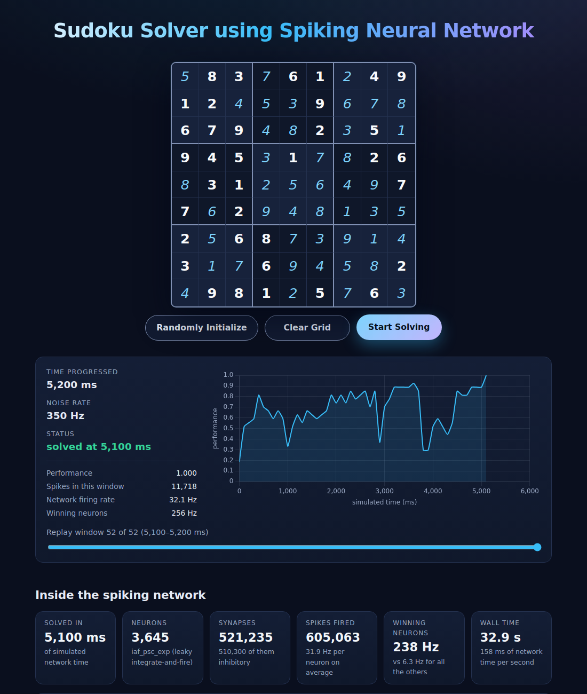

# Sudoku Solver using Spiking Neural Network

A web app that solves Sudoku with a **spiking neural network** simulated in
[NEST](https://www.nest-simulator.org/). You enter a puzzle (or generate one)
and the network runs on the server. Every 100 ms of simulated time is streamed
to the browser, so you watch the board settle and the network's activity
change live. It keeps going until the puzzle is solved.



The network comes from the NEST example
[`pynest/examples/sudoku`](https://github.com/nest/nest-simulator/tree/master/pynest/examples/sudoku)
by J. Gille, S. Furber and A. Rowley, which is based on the original SpiNNaker
implementation. It has 729 populations of 5 `iaf_psc_exp` neurons each (3,645
neurons) and 521,235 synapses. The Sudoku rules are wired in as inhibition:
each population inhibits the same digit in its row, column and box, and the
other digits of its own cell. Given digits receive extra Poisson input, and
background noise makes the network explore until no rule is broken.0

## How it always finishes

The original example stops after a fixed time. The network is stochastic and
can stall: a few cells keep a conflict for seconds, or it settles on a valid
grid that overrides a given digit. This app adds a small controller around the
unchanged network (`backend/snn/simulation.py`):

* **Kick.** If the number of conflicts hasn't improved for 5 windows (0.5 s),
  the winning populations of the conflicting cells, and any wrong digit on a
  given cell, are silenced for 50 ms. A rival digit can then take over. This
  is the spiking equivalent of a local-search "flip". If a kick doesn't help,
  the next one silences every non-given cell in the affected rows, columns and
  boxes, so that region re-solves against the rest of the grid.
* **Restart.** If several kicks in a row bring no improvement, all membrane
  potentials are re-randomised and the search starts afresh.
* **Hint (last resort).** If the puzzle is still unsolved after 15 s of
  simulated time, each restart also stimulates 4 more empty cells with their
  correct digit, taken from a classical solver. These are mostly cells the
  network was struggling with, and they get the same Poisson input as a given.
  The network still solves every other cell. Hints only ever grow, so every
  puzzle is eventually solved. Easy puzzles normally finish before hints
  start. Hints are not shown in the web interface; set `HINT_AFTER_MS=-1`
  for a pure-network run.
* **No overall time limit.** A request stops when its wall-clock budget runs
  out (`WALL_BUDGET_S`, default 240 s, below Vercel's 300 s limit). The browser
  then sends a follow-up request that rebuilds the network with a new seed and
  continues the same timeline, carrying over any hints. Dropped connections are
  retried the same way. Unsolvable puzzles are rejected up front.

## What the page shows

The page is dark-themed throughout.

* **Input:** the 9×9 grid and three buttons: **Randomly Initialize** (a
  36-given puzzle with one solution), **Clear Grid** and **Start Solving**.
  Duplicates are highlighted while you type. After a run, editing a cell
  continues from the board as shown.
* **Live:** the board as the network reads it out every 100 ms (network
  digits in light-blue italics, red bars and frames on broken rows, columns
  and boxes), the time progressed, and a plot of performance over simulated
  time. After the run, a slider replays any window.
* **Inside the spiking network** (after the run):
  * headline numbers: neurons, synapses, spikes fired, and the firing rates of
    winning neurons against the rest;
  * **one cell up close:** a raster of all 45 neurons of a chosen cell in the
    final 100 ms, and the membrane potential of a winning neuron against a
    runner-up neuron, recorded with a NEST multimeter;
  * the winner-take-all competition across the board over time;
  * the distribution of per-neuron firing rates.

## Run locally

You need Python 3.12 (3.9–3.13 work) and Node.js 20+. NEST has no native
Windows wheel, so on Windows use WSL2.

```bash
# backend (terminal 1)
cd backend
python3.12 -m venv .venv && source .venv/bin/activate
pip install -r requirements.txt -r requirements-dev.txt
uvicorn main:app --port 8000

# frontend (terminal 2)
cd frontend
npm install
npm run dev            # open http://localhost:5173 (proxies /api to :8000)
```

## Tests

```bash
cd backend && python -m pytest -q     # engine, controller and API
cd frontend && npm test               # sudoku logic, Start-button rules, continuation
```

GitHub Actions (`.github/workflows/ci.yml`) runs both suites on every push.

## Deploy (Vercel)

`vercel.json` defines one Vercel project with two services: the Vite frontend
(`web`) and the FastAPI backend (`api`, 300 s max duration, 2 GB). Deploy it
either way:

* **Dashboard:** import the GitHub repo into Vercel, keep the root directory
  at the repo root, and deploy.
* **CLI:** run `npm i -g vercel && vercel login && vercel` for a preview, then
  `vercel --prod`.

After deploying, open `/api/health`. It should report `"nest": "3.10.0"` and
`spikes > 0`.

| Env var | Default | Meaning |
|---|---|---|
| `WALL_BUDGET_S` | 240 | Wall-clock seconds one request may run before the browser continues with a new one (10–280) |
| `HINT_AFTER_MS` | 15000 | Simulated time after which restarts add hints; `-1` disables them (the run may then take very long on hard puzzles) |
| `NOISE_RATE` | 350 | Background Poisson rate (Hz) |
| `VITE_API_BASE` | *(empty)* | Set only when the backend runs elsewhere |
| `CORS_ORIGINS` | *(empty)* | Comma-separated origins allowed to call a separately hosted backend |

Vercel Hobby includes 4 active-CPU hours a month. A typical solve takes
10–60 CPU-seconds, and a hard puzzle can take several minutes.

If NEST can't run as a Vercel function, deploy `backend/` with its
`Dockerfile` to another host and point the frontend at it with
`VITE_API_BASE`. The build guide's Appendix 2 lists the options.

## API

* `GET /api/health` runs a 10-neuron NEST smoke test. Use it to warm up a cold
  instance.
* `POST /api/solve` takes the following body:

  ```json
  {"puzzle": [[...9 ints...] x 9], "seed": 123, "t_offset_ms": 0, "segment": 0, "hints": []}
  ```

  Only `puzzle` is required. `t_offset_ms`, `segment` and `hints` continue
  an earlier request. The response is an NDJSON stream:
  * one `meta` line;
  * one `step` line per 100 ms window;
  * then `done` or `error`.
  
  When `done` has `resume: true`, the request ran out of its budget and the
  client should continue. An invalid or unsolvable board returns `422`. If a
  run is already in progress, it returns `429` (the frontend retries).

## Layout

```
backend/   FastAPI app (main.py) and the snn package:
           sudoku_net.py (NEST network, verbatim + one upstream bug fix),
           simulation.py (build, run loop, kick/restart/hint controller),
           engine.py (runs NEST on one dedicated thread),
           analysis.py (network statistics), encoding.py,
           helpers.py (validation, classical solver)
frontend/  Vite + React + TypeScript: grid, controls, live panel, results
docs/      original build guide, reference copy of sudoku_net.py, screenshot
```

**All NEST calls run on one dedicated thread.** NEST segfaults if it is
imported on one Python thread and driven from another, which a thread-pooled
web server would otherwise do.

`docs/BUILD_GUIDE.md` is the original specification. Since it was written,
this app has replaced the fixed time limit with the kick/restart/hint
controller and continuation requests, removed the spike raster, and reduced the report to the
views described above.

## Licence

GPL-2.0-or-later. See [LICENSE](LICENSE) and [NOTICE](NOTICE). The network and
the ported helpers are © The NEST Initiative.
